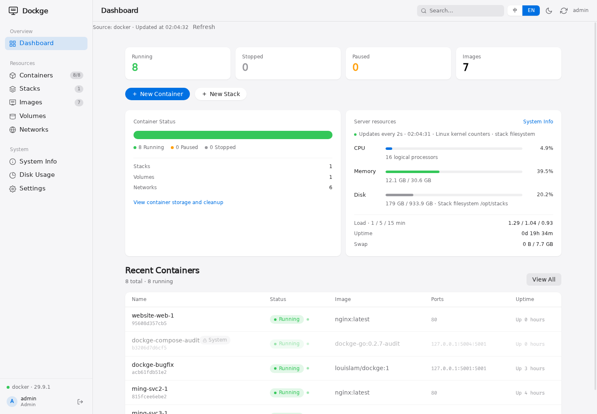
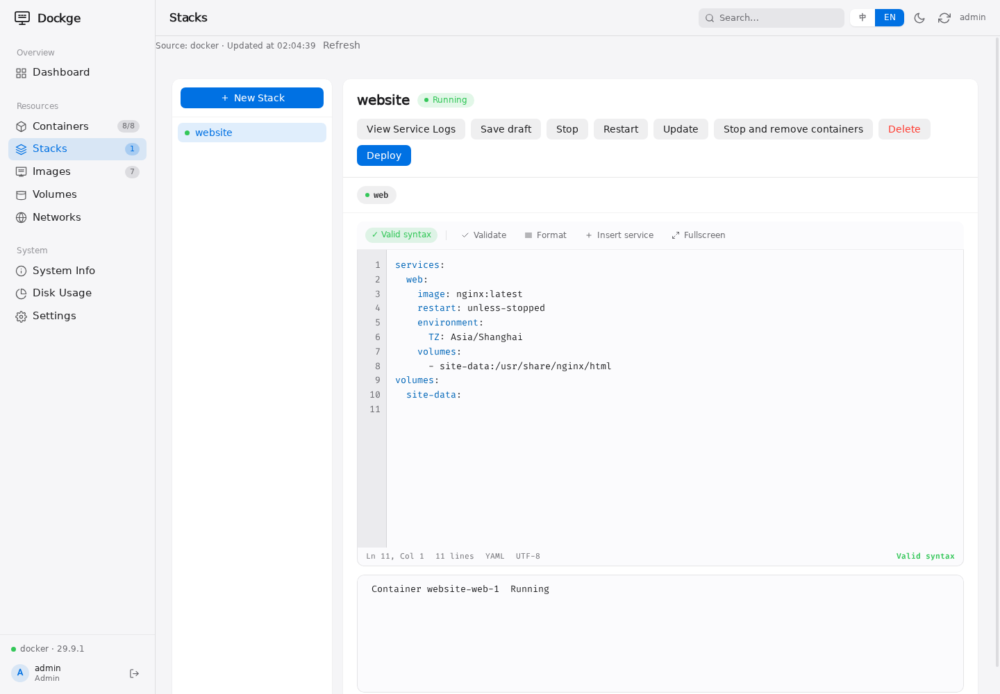

# Dockge

**English** · [简体中文](README.zh-CN.md) · [Releases](https://github.com/dockge-go/dockge/releases)

Manage Compose stacks from your browser. Edit YAML, deploy services, follow logs and open a shell inside a container. Based on [louislam/dockge](https://github.com/louislam/dockge).



## What you can do

- Create, validate, save and delete `compose.yaml` in the stack directory.
- Start, stop and restart stacks; manage containers, images, volumes and networks.
- Follow deployment output, container logs and terminal sessions over SSE.
- Monitor CPU, memory and disk usage, with light and dark themes.
- Use one administrator account, with password or OIDC sign-in.

Stack deletion removes exclusive resources and the stack directory. Shared or external resources and bind paths outside the stack are retained and listed before deletion.

<details>
<summary>YAML editor and deployment output</summary>



</details>

## Get started

Requires Docker Engine and Compose. Build and start the current source:

```sh
git clone https://github.com/dockge-go/dockge.git
cd dockge
mkdir -p stacks
docker compose -f deploy/compose.yaml up -d --build
```

Open `http://localhost:5001` and create the administrator. **There is no default password.** Restrict initial access and use HTTPS in production.

Only two mounts are needed: the runtime socket and stack directory. Internal paths remain `/opt/stacks`, `/app/data` and port `5001`; change only the external side of the mounts. Account data is stored in `stacks/.dockge-data`—include hidden files in backups. Existing `/app/data` mounts remain supported.

> Access to the runtime socket grants extensive host privileges. Only trusted administrators should have access. Removing the panel does not remove its stacks or data.

Release images: [Docker Hub](https://hub.docker.com/r/makeshit/dockge) · [GHCR](https://github.com/orgs/dockge-go/packages/container/package/dockge). Pin a published version or digest; build from source to use changes not yet released.

## Published image

```sh
docker run -d --name dockge --restart unless-stopped -p 5001:5001 \
  -v /var/run/docker.sock:/var/run/docker.sock \
  -v /opt/stacks:/opt/stacks ghcr.io/dockge-go/dockge:0.2.8
```

The Docker Hub mirror is `makeshit/dockge:0.2.8`. [Deployment, OIDC and upgrades](deploy/README.md).

## Operations

Change your password in **Settings**. For a forgotten password, stop the panel, back up stacks and the database, move `stacks/.dockge-data/dockge.db` to a secure location, then restart and create the administrator through a restricted endpoint. This resets the account and settings and invalidates old sessions; it does not delete workloads. OIDC passwords are reset at the identity provider.

[Backup, migration, metrics and release workflows](deploy/README.md)

## Development

```sh
make verify    # Build and run tests
make image     # Build dockge-go:local
```

Supported deployment: one Docker Engine with Docker Compose v2. The image includes Docker CLI and the Compose plugin.

[MIT License](LICENSE)
