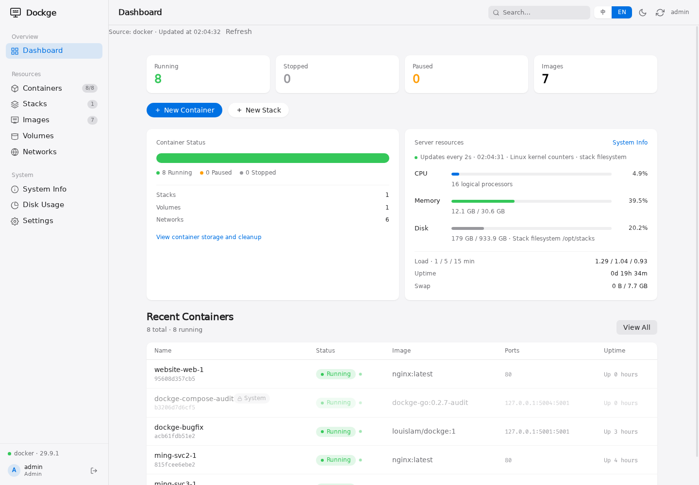
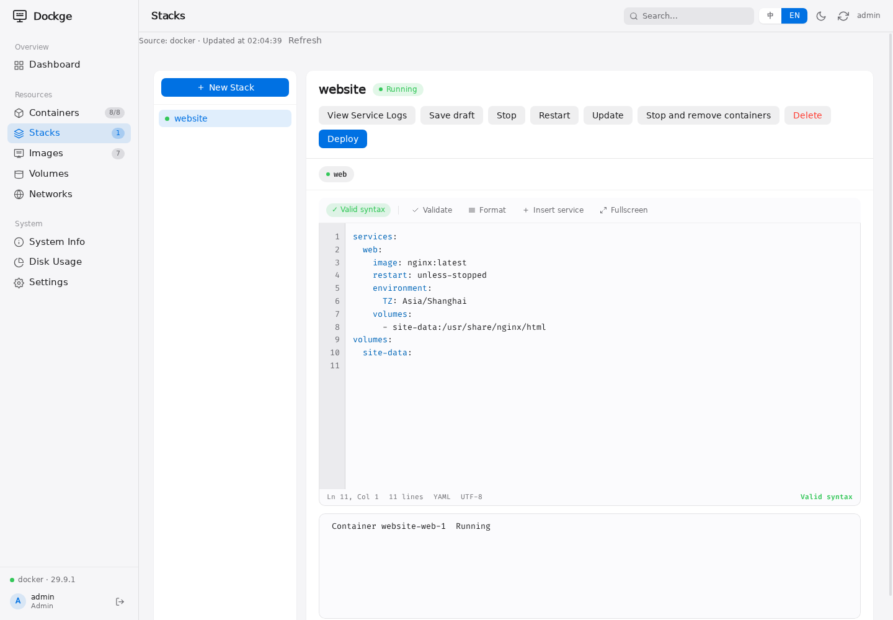

# Dockge

[English](README.md) · **简体中文** · [版本发布](https://github.com/dockge-go/dockge/releases)

在浏览器中管理 Compose 栈：编辑 YAML、部署服务、查看日志、进入容器终端。基于 [louislam/dockge](https://github.com/louislam/dockge)。



## 功能

- 在栈目录中新增、校验、保存和删除 `compose.yaml`。
- 启停、重启编排栈；管理容器、镜像、数据卷和网络。
- 通过 SSE 查看部署输出、容器日志和终端会话。
- 查看 CPU、内存和磁盘用量，支持明暗主题。
- 一个管理员账号，可使用密码或 OIDC 登录。

删除栈会清理专属资源和栈目录。共享资源、external 资源及栈外绑定路径会保留，删除前列出范围与原因。

<details>
<summary>YAML 编辑与部署输出</summary>



</details>

## 快速开始

需要 Docker Engine 和 Compose。构建并启动当前源码：

```sh
git clone https://github.com/dockge-go/dockge.git
cd dockge
mkdir -p stacks
docker compose -f deploy/compose.yaml up -d --build
```

访问 `http://localhost:5001`，创建管理员账号。**没有默认密码。** 首次初始化请限制访问，生产环境使用 HTTPS。

只需要运行时 socket 和栈目录两个挂载。内部路径固定为 `/opt/stacks`、`/app/data`，端口为 `5001`；更换目录只改挂载的外部路径。账号数据保存在 `stacks/.dockge-data`，备份时须包含隐藏目录。旧的 `/app/data` 挂载仍可使用。

> 运行时 socket 提供较高的宿主权限，请只向可信管理员开放。卸载面板不会自动删除栈或数据。

发布镜像：[Docker Hub](https://hub.docker.com/r/makeshit/dockge) · [GHCR](https://github.com/orgs/dockge-go/packages/container/package/dockge)。生产使用已发布的固定版本或摘要；尚未发布的改动请从源码构建。

## 使用发布镜像

```sh
docker run -d --name dockge --restart unless-stopped -p 5001:5001 \
  -v /var/run/docker.sock:/var/run/docker.sock \
  -v /opt/stacks:/opt/stacks makeshit/dockge:0.2.9
```

GHCR 同步镜像为 `ghcr.io/dockge-go/dockge:0.2.9`；私有包拉取需要 `read:packages` 凭据。[部署、OIDC 与升级](deploy/README.md)。

## 日常维护

在**设置**中修改密码。忘记密码时，先停机并备份栈和数据库，将 `stacks/.dockge-data/dockge.db` 移到安全位置，再重启并在受限入口创建管理员。这会重置账号和设置、使旧会话失效，不删除业务服务。OIDC 密码在身份提供方重置。

[备份、迁移、指标与发布流程](deploy/README.md)

## 开发

```sh
make verify    # 构建并运行测试
make image     # 构建 dockge-go:local
```

支持单机 Docker Engine 与 Docker Compose v2，镜像自带 Docker CLI 和 Compose 插件。

[MIT 许可证](LICENSE)
